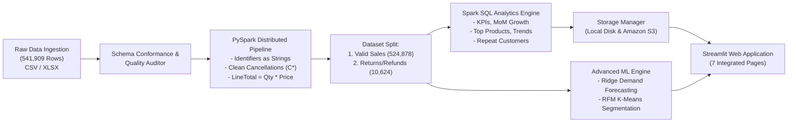

# SalesPulse Analytics ⚡
### E-Commerce Sales Analytics Using Big Data and Cloud Computing
*A Combined B.Tech Project for **Big Data Analytics (BDA)** and **Cloud Computing (CC)***


---

## 1. Project Overview

**SalesPulse Analytics** is an end-to-end Big Data and Cloud Computing enterprise web application. It ingests 541,909 real-world e-commerce transaction logs from the **UCI Online Retail dataset**, conducts distributed cleaning and transformations in **Apache Spark (PySpark)**, performs aggregations via **Spark SQL**, persists data locally and to **Amazon S3** under structured enterprise prefixes, and presents insights through an interactive **Streamlit** dashboard.

### Core Academic Integration:
- **Big Data Analytics (BDA)**: In-memory distributed processing via PySpark 3.5, Catalyst query optimization, Spark SQL aggregations, window functions, and controlled synthetic scalability benchmarking.
- **Cloud Computing (CC)**: Hybrid storage layer supporting ₹0 offline development and private Amazon S3 replication (`raw/`, `processed/`, `analytics/`, `reports/`, `metadata/`), least-privilege IAM policies, and cloud deployment runbooks.

---

## 2. Architecture & Pipeline



---

## 3. Technology Stack

- **Data Processing & Big Data**: Apache Spark 3.5.9, PySpark, Spark SQL
- **User Interface**: Streamlit, Plotly Express & Graph Objects
- **Cloud Infrastructure**: Amazon S3 (Private, SSE-AES256), AWS IAM, AWS EC2 / CloudWatch guides
- **Machine Learning**: Scikit-Learn (Ridge Regression, K-Means Clustering, StandardScaler)
- **Data Persistence**: Apache Parquet (Snappy), CSV, JSON
- **Quality & Testing**: pytest (29 Automated Unit & Integration Tests)
- **Programming Language**: Python 3.13

---

## 4. Ground Truth Dataset & Verified Results

Audited directly against the canonical **UCI Online Retail Dataset**:

| Metric | Verified Real Dataset Value | Notes |
| :--- | :--- | :--- |
| **Total Ingested Records** | **541,909** | Matches canonical UCI benchmark count |
| **Clean Valid Sales** | **524,878** | Positive quantity & unit price, non-cancelled |
| **Cancellations & Returns** | **9,288** invoices / 10,624 lines | Invoices starting with 'C' or negative quantity |
| **Gross Revenue** | **£10,642,110.80** | Total sales before return deductions |
| **Return Adjustments** | **£893,979.73** | Total refunded merchandise |
| **Net Revenue** | **£9,748,131.07** | Gross revenue minus return deductions |
| **Units Sold** | **5,588,376 units** | Net product volume |
| **Distinct Commercial Orders** | **20,728 orders** | Unique valid invoices |
| **Average Order Value (AOV)** | **£513.42** | Gross sales / Total orders |
| **Primary Currency** | **GBP (£)** | UK Retailer origin (No fabricated INR conversion) |
| **Pipeline Throughput** | **1,809.9 rows/sec** | Measured local CPU batch throughput |

> [!NOTE]
> **Profit Policy**: The UCI Online Retail dataset contains retail selling prices (`UnitPrice`) but lacks Cost of Goods Sold (COGS). Therefore, profit and margin figures are deliberately **not** claimed.

---

## 5. Dashboard Pages

1. **💼 Sales Overview**: Executive KPIs (Gross Sales, Net Sales, Return Rate %, Distinct Orders, AOV), monthly revenue trend, top 5 products, and checkout comparisons.
2. **📦 Product Analytics**: Top 20 revenue-generating products, volume rankings, and interactive catalog keyword search.
3. **📈 Sales Trends**: Monthly progression, Month-over-Month (MoM) revenue growth (%), daily fluctuations, and day-of-week / hourly seasonality.
4. **🌍 Customer and Regional**: Geographic revenue distribution, UK (domestic) vs International markets, and repeat customer retention breakdown.
5. **🛡️ Data Management & Quality**: Pipeline execution controls, data quality health audit (nulls, duplicates, anomalies), and Amazon S3 sync controls.
6. **🔮 Forecasting & Segmentation**: 30-day predictive demand forecasting with hold-out error evaluation (MAE, RMSE, MAPE) and RFM customer segmentation via K-Means clustering.
7. **⚡ System Performance**: PySpark execution latency breakdown by stage, throughput metrics, and synthetic scalability benchmarks.

---

## 6. Directory Structure

```
ecommerce-sales-analytics/
├── app.py                      # Main Streamlit Application Entrance
├── requirements.txt            # Python Dependencies
├── README.md                   # Project Documentation
├── .gitignore                  # Git Ignore Rules
├── .env.example                # Environment Variable Template
├── config/
│   ├── __init__.py
│   └── settings.py             # Central Project Configuration
├── data/
│   ├── raw/                    # Raw Dataset (OnlineRetail.csv)
│   ├── processed/              # Cleaned Parquet & CSV Datasets
│   ├── analytics/              # Aggregated Analytics Summary Tables
│   ├── reports/                # Data Quality Audit JSON Reports
│   └── metadata/               # Pipeline Run Telemetry
├── src/
│   ├── ingestion/              # Ingestion & Timestamp Parsing (CSV/XLSX)
│   ├── validation/             # Schema & Data Quality Auditor
│   ├── processing/             # PySpark Cleaning, SparkSession, Pipeline
│   ├── analytics/              # Spark SQL Aggregations, Forecasting, Benchmarking
│   ├── storage/                # Unified Local & Amazon S3 Storage Manager
│   └── dashboard/              # Streamlit Pages & Plotly Themes
├── tests/                      # Automated pytest Suite (29 Tests)
└── docs/
    ├── architecture.md         # System Architecture & Design
    ├── bda_spark_methodology.md# Big Data Analytics Theory & Principles
    ├── cloud_computing_aws_guide.md # AWS S3, IAM, & EC2 Runbooks
    └── viva_questions_answers.md    # 20 High-Yield Viva Q&As
```

---

## 7. Installation & Quickstart

### Step 1: Clone the Repository & Create Virtual Environment
```bash
git clone https://github.com/<your-username>/ecommerce-sales-analytics.git
cd ecommerce-sales-analytics

# Create virtual environment
python -m venv .venv

# Activate virtual environment
# Windows:
.\.venv\Scripts\activate
# Linux/macOS:
source .venv/bin/activate
```

### Step 2: Install Dependencies
```bash
pip install -r requirements.txt
```

### Step 3: Run the Automated Test Suite
Verify that all 29 unit and integration tests pass:
```bash
pytest -v
```

### Step 4: Run the Big Data Pipeline (Optional CLI Execution)
To process the dataset and generate all summary tables:
```bash
python -c "from src.processing.pipeline import run_pipeline; run_pipeline()"
```

### Step 5: Launch the SalesPulse Analytics Dashboard
```bash
streamlit run app.py
```
Open your browser at `http://localhost:8501`.

---

## 8. AWS Cloud Integration (₹0 Out-of-Pocket)

SalesPulse Analytics runs 100% offline in local mode by default. To connect to AWS Amazon S3 without incurring costs:

1. Copy `.env.example` to `.env`:
   ```bash
   cp .env.example .env
   ```
2. Set `STORAGE_MODE=s3` and configure your private bucket name:
   ```env
   STORAGE_MODE=s3
   AWS_REGION=us-east-1
   AWS_S3_BUCKET=your-private-bucket-name
   ```
3. Use AWS credentials via `aws configure` or set `AWS_ACCESS_KEY_ID` and `AWS_SECRET_ACCESS_KEY` in `.env`.
4. The application organizes all cloud objects under structured prefixes:
   - `raw/`: Raw transactional drops
   - `processed/`: Cleansed sales data
   - `analytics/`: Aggregated tables
   - `reports/`: Data quality audit reports
   - `metadata/`: Pipeline execution logs

---

## 9. Academic Project Verification

For project defense and viva preparation, refer to the documentation:
- 📖 [System Architecture Documentation](docs/architecture.md)
- 📊 [Big Data Analytics & Spark Methodology](docs/bda_spark_methodology.md)
- ☁️ [Cloud Computing & AWS Deployment Guide](docs/cloud_computing_aws_guide.md)
- 🎓 [Viva Questions & Detailed Answers](docs/viva_questions_answers.md)
