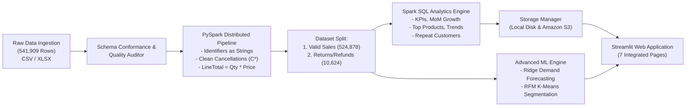

# SalesPulse Analytics ⚡
### E-Commerce Sales Analytics Using Big Data and Cloud Computing
*A Combined B.Tech Capstone Project for **Big Data Analytics (BDA)** and **Cloud Computing (CC)***


-yellow.svg)


---

## 1. Project Overview

**SalesPulse Analytics** is an end-to-end Big Data Analytics and Cloud Computing web application designed for academic excellence and enterprise rigor. It ingests 541,909 real-world e-commerce transaction logs from the canonical **UCI Online Retail benchmark dataset**, conducts distributed schema validation and data quality auditing in **Apache Spark (PySpark 3.5)**, performs multidimensional aggregations via **Spark SQL**, persists data locally and to **Amazon S3** under structured logical prefixes, and presents insights through an interactive, responsive **Streamlit** dashboard.

### Core Academic Subjects Integrated:
- **Big Data Analytics (BDA)**: Distributed in-memory data processing using PySpark 3.5, Catalyst query optimization, Spark SQL aggregations, window functions, hold-out demand forecasting, RFM K-Means clustering, and controlled synthetic scalability benchmarking.
- **Cloud Computing (CC)**: Hybrid storage architecture supporting ₹0 out-of-pocket offline development, mock-tested private Amazon S3 replication (`raw/`, `processed/`, `analytics/`, `reports/`, `metadata/`), least-privilege IAM policies, and documented AWS deployment runbooks.

---

## 2. Architecture & Pipeline



---

## 3. Technology Stack

- **Data Processing & Big Data**: Apache Spark 3.5.9, PySpark, Spark SQL
- **User Interface & Visualizations**: Streamlit (native bordered layout), Plotly Express & Graph Objects
- **Cloud Infrastructure (Mock-Tested)**: Amazon S3 (Private, SSE-AES256), AWS IAM, AWS EC2 / CloudWatch guides
- **Machine Learning & Analytics**: Scikit-Learn (Ridge Regression, K-Means Clustering, StandardScaler)
- **Data Persistence**: Apache Parquet (Snappy), CSV, JSON
- **Quality & Testing**: pytest (39 Automated Unit & Integration Tests, 100% Pass Rate)
- **Programming Language**: Python 3.13 on Windows / Linux

---

## 4. Indian-First Localization & Currency Management

SalesPulse Analytics provides native support for Indian business conventions while strictly preserving canonical dataset integrity:

- **Locale & Timezone**: Configured for `en-IN` and `Asia/Kolkata`.
- **Date Formatting**: Displayed uniformly in standard `DD-MM-YYYY` format.
- **Indian Number Grouping**: Formats figures according to the Indian numbering system (`1,00,000` for 1 Lakh, `10,00,000` for 10 Lakh, and `1,00,00,000` for 1 Crore).
- **Lakh & Crore Compact Views**: Uses `Cr`, `L`, and `K` notations for compact commercial metrics.
- **Indian Financial Year (FY)**: Follows the statutory 1 April to 31 March fiscal year (e.g. `FY 2010-11`, `FY 2011-12`) with quarterly segmentation (`Q1 Apr-Jun`, `Q2 Jul-Sep`, `Q3 Oct-Dec`, `Q4 Jan-Mar`).
- **Dual Currency Presentation**:
  1. **Canonical GBP (£) Default**: Preserves original British Pounds (£) without automatic or silent conversion.
  2. **Converted INR (₹) Mode**: Dynamically converts amounts using an explicitly disclosed reference rate (default: `1 GBP = ₹106.50`, configurable in sidebar settings) with clear source, target, and reference date disclosure.

---

## 5. Ground Truth Dataset & Verified Results

Audited directly against the canonical **UCI Online Retail Dataset**:

| Metric | Verified Real Dataset Value | Notes |
| :--- | :--- | :--- |
| **Total Ingested Records** | **541,909** | Matches canonical UCI benchmark count |
| **Clean Valid Sales** | **524,878** | Positive quantity & unit price, non-cancelled |
| **Cancellations & Returns** | **9,288** invoices / 10,624 lines | Invoices starting with 'C' or negative quantity |
| **Gross Revenue** | **£10,642,110.80** | Total sales before return deductions |
| **Return Adjustments** | **£893,979.73** | Total refunded merchandise |
| **Net Revenue** | **£9,748,131.07** | Gross revenue minus return deductions |
| **Units Sold** | **5,588,376 units** | Net product volume |
| **Distinct Commercial Orders** | **20,728 orders** | Unique valid invoices |
| **Average Order Value (AOV)** | **£513.42** | Gross sales / Total orders |
| **Primary Currency** | **GBP (£)** | UK Retailer origin (INR dynamically available) |
| **Pipeline Throughput** | **1,809.9 rows/sec** | Measured local CPU batch throughput |

> [!NOTE]
> **Profit Policy**: The UCI Online Retail dataset contains retail selling prices (`UnitPrice`) but lacks Cost of Goods Sold (COGS). Therefore, profit and margin claims are deliberately **not** fabricated, adhering to strict academic integrity.

---

## 6. Dashboard Pages

1. **💼 Sales Overview**: Executive KPIs (Gross Sales, Net Sales, Return Rate %, Distinct Orders, AOV), Indian Financial Year (FY) filter, monthly revenue progression, top 5 products, and customer mix.
2. **📦 Product Analytics**: Top 20 revenue-generating products, volume rankings, pricing band analysis, and interactive SKU keyword search.
3. **📈 Sales Trends**: Monthly progression, Month-over-Month (MoM) revenue growth (%), Indian FY quarter filters, daily sales progression, and day-of-week / hourly seasonality patterns.
4. **🌍 Customer and Regional**: Geographic revenue distribution, domestic (UK) vs international markets, repeat buyer share, and customer retention dynamics.
5. **🛡️ Data Management & Quality**: 4-step dataset import and processing interface (Select ➔ Validate & Preview ➔ Configure & Process ➔ Results & Exports), data quality audit, and Amazon S3 management.
6. **🔮 Forecasting & Segmentation**: 30-day predictive demand forecasting with hold-out validation (MAE, RMSE, MAPE) and RFM customer behavioral clustering (K-Means).
7. **⚡ System Performance**: PySpark execution latency breakdown by stage, throughput metrics, and controlled scalability experiments.

---

## 7. 4-Step Data Ingestion Interface

Page 5 incorporates a complete 4-step data engineering workflow:

- **Step 1: Select Dataset**: Choose between the canonical UCI dataset, lightweight sample, or upload custom CSV/Excel files (with drag-and-drop, extension validation, and 100MB size limit check).
- **Step 2: Validate & Preview (Non-blocking)**: Inferred data types, null counts, duplicate inspection, preview of top 15 records, intelligent schema mapping using aliases (e.g. `order_id` ➔ `InvoiceNo`, `price` ➔ `UnitPrice`), and clear `Valid`/`Warning`/`Invalid` status badges.
- **Step 3: Configure & Process**: Select execution scale (Full dataset vs 5k, 25k, 50k row limits), review execution workload, and click `⚡ Execute Big Data Pipeline` with genuine stage progress tracking.
- **Step 4: Results & Exports**: Input vs accepted vs returned vs excluded record accounting, duration, throughput, and one-click downloads for clean CSVs, KPI summaries, and data quality audits.

---

## 8. Directory Structure

```
ecommerce-sales-analytics/
├── app.py                      # Main Streamlit Application Entrance
├── requirements.txt            # Python Dependencies
├── README.md                   # Project Documentation
├── .gitignore                  # Git Ignore Rules
├── .env.example                # Environment Variable Template
├── config/
│   ├── __init__.py
│   └── settings.py             # Central Project Configuration
├── data/
│   ├── raw/                    # Raw Dataset (OnlineRetail.csv)
│   ├── processed/              # Cleaned Parquet & CSV Datasets
│   ├── analytics/              # Aggregated Analytics Summary Tables
│   ├── reports/                # Data Quality Audit JSON Reports
│   └── metadata/               # Pipeline Run Telemetry
├── src/
│   ├── ingestion/              # Ingestion & Timestamp Parsing (CSV/XLSX)
│   ├── validation/             # Schema & Data Quality Auditor
│   ├── processing/             # PySpark Cleaning, SparkSession, Pipeline
│   ├── analytics/              # Spark SQL Aggregations, Forecasting, Benchmarking
│   ├── storage/                # Unified Local & Amazon S3 Storage Manager
│   └── dashboard/              # Streamlit Pages & Plotly Themes
├── tests/                      # Automated pytest Suite (39 Tests)
└── docs/
    ├── architecture.md         # System Architecture & Design
    ├── bda_spark_methodology.md# Big Data Analytics Theory & Principles
    ├── cloud_computing_aws_guide.md # AWS S3, IAM, & EC2 Runbooks
    └── viva_questions_answers.md    # 20 High-Yield Viva Q&As
```

---

## 9. Installation & Quickstart

### Step 1: Clone the Repository & Create Virtual Environment
```bash
git clone https://github.com/<your-username>/ecommerce-sales-analytics.git
cd ecommerce-sales-analytics

# Create virtual environment
python -m venv .venv

# Activate virtual environment
# Windows:
.\.venv\Scripts\activate
# Linux/macOS:
source .venv/bin/activate
```

### Step 2: Install Dependencies
```bash
pip install -r requirements.txt
```

### Step 3: Run the Automated Test Suite
Verify that all 39 unit and integration tests pass:
```bash
pytest -v
```

### Step 4: Run the Big Data Pipeline (Optional CLI Execution)
To process the dataset and generate all analytical summary tables:
```bash
python -c "from src.processing.pipeline import run_pipeline; run_pipeline()"
```

### Step 5: Launch the SalesPulse Analytics Dashboard
```bash
streamlit run app.py
```
Open your browser at `http://localhost:8501`.

---

## 10. AWS Cloud Integration & ₹0 Cost Safety

SalesPulse Analytics strictly operates in **local offline mode** by default with zero cloud costs incurred. Amazon S3 integration is verified via automated mocks.

When authorized for future cloud deployment:
1. Copy `.env.example` to `.env`:
   ```bash
   cp .env.example .env
   ```
2. Set `STORAGE_MODE=s3` and configure your private bucket name:
   ```env
   STORAGE_MODE=s3
   AWS_REGION=us-east-1
   AWS_S3_BUCKET=your-private-bucket-name
   ```
3. Use AWS credentials via `aws configure` or set IAM role credentials.
4. The application organizes all cloud objects under structured prefixes:
   - `raw/`: Raw transactional drops
   - `processed/`: Cleansed sales data (Parquet)
   - `analytics/`: Aggregated tables
   - `reports/`: Data quality audit reports
   - `metadata/`: Pipeline execution logs

---

## 11. Academic Project Verification

For project defense and viva preparation, refer to the documentation:
- 📖 [System Architecture Documentation](docs/architecture.md)
- 📊 [Big Data Analytics & Spark Methodology](docs/bda_spark_methodology.md)
- ☁️ [Cloud Computing & AWS Deployment Guide](docs/cloud_computing_aws_guide.md)
- 🎓 [Viva Questions & Detailed Answers](docs/viva_questions_answers.md)
