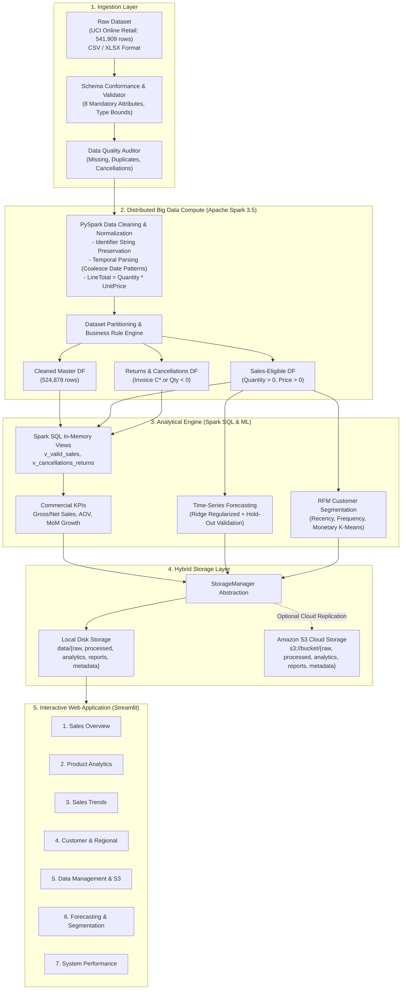

# SalesPulse Analytics - System Architecture & Engineering Design

## 1. High-Level Architecture Overview

SalesPulse Analytics integrates **Big Data Analytics (BDA)** and **Cloud Computing (CC)** into a single unified analytical pipeline. The architecture decouples distributed compute from durable object storage, enabling seamless transition between **₹0 local development** and **AWS Cloud infrastructure**.

---

## 2. Key Architecture Pillars

### Decoupled Storage and Compute
- **Compute Layer**: Apache Spark (via PySpark 3.5) runs compute workloads in-memory. In local mode, JVM workers run on allocated cores (`local[2]`), while in cloud mode, the identical PySpark codebase runs on AWS EMR (Elastic MapReduce) or an EC2 cluster.
- **Storage Layer**: Transparent persistence abstracted by `StorageManager`. Files are stored under standard prefixes:
  - `raw/`: Immutable source transactional logs.
  - `processed/`: Cleansed, strongly-typed Parquet and CSV files.
  - `analytics/`: Summary aggregation tables for sub-second dashboard rendering.
  - `reports/`: Data quality audit JSON/CSV reports.
  - `metadata/`: Execution telemetry (durations, throughput, memory).

### Zero-Fabrication Integrity Policy
- **Currency**: Transactions originate from a UK-based retailer in Great Britain Pounds (£). No silent conversions to INR or USD are performed.
- **Financial Metrics**:
  $$\text{Gross Sales} = \sum (\text{Quantity} \times \text{UnitPrice}) \quad \forall \text{ valid sales}$$
  $$\text{Return Adjustments} = \left| \sum (\text{Quantity} \times \text{UnitPrice}) \right| \quad \forall \text{ cancellations/refunds}$$
  $$\text{Net Sales} = \text{Gross Sales} - \text{Return Adjustments}$$
- **Profit Disclaimer**: Since Cost of Goods Sold (COGS) is absent in the UCI dataset, profit margins are explicitly **not** claimed.
