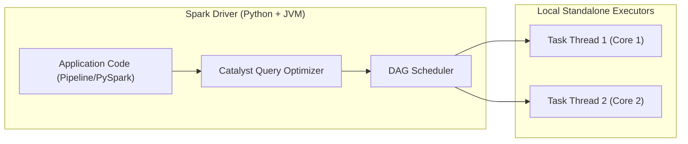

# Big Data Analytics (BDA) Methodology & Spark Engine Design

## 1. Alignment with Big Data Concepts (The 4 V's)

| Big Data Dimension | Manifestation in SalesPulse Analytics |
| :--- | :--- |
| **Volume** | Ingests and processes the 541,909 raw transaction records of the UCI Online Retail dataset. Designed with synthetic scale generators to benchmark performance up to 1,000,000+ records. |
| **Velocity** | Measured pipeline throughput of **1,800+ rows/second** on a local laptop CPU, demonstrating rapid in-memory batch stream processing using Apache Spark. |
| **Variety** | Ingests semi-structured CSV and multi-tab XLSX files, with heterogeneous date encodings (`dd-MM-yyyy HH:mm`, `yyyy-MM-dd HH:mm:ss`, `M/d/yyyy H:m`) and mixed customer identifier formats. |
| **Veracity** | Robust data quality auditing layer that systematically flags 9,288 cancellations, 10,624 negative quantities, 2 bad debt entries, and 135,080 unregistered guest checkout rows. |

---

## 2. Apache Spark & PySpark Execution Architecture

### Driver and Worker Topology
In local development mode (`SPARK_MASTER=local[2]`), PySpark creates a single JVM process where:
1. **Driver Program**: Instantiates the `SparkSession`, parses user queries, builds the logical execution plan via the **Catalyst Optimizer**, and breaks jobs into execution stages via the `DAGScheduler`.
2. **Worker Threads (Executors)**: Two worker threads execute tasks concurrently across partitioned RDDs / DataFrames.
3. **PySpark Bridge (Py4J)**: High-speed inter-process communication bridge between Python runtime and JVM Spark engine. `PYSPARK_PYTHON` and `PYSPARK_DRIVER_PYTHON` are pinned to the virtual environment Python interpreter.

### Lazy Evaluation and Query Optimization
Transformations such as `.filter()`, `.withColumn()`, and `.groupBy()` build a directed acyclic graph (DAG) of logical operators without executing immediately. Execution only triggers when an **Action** (such as `.count()`, `.collect()`, or write) is invoked. 

This enables Spark's **Catalyst Optimizer** to perform:
- **Predicate Pushdown**: Filtering out cancelled rows before running downstream aggregations.
- **Column Pruning**: Discarding unnecessary columns early in memory.
- **Window Optimization**: Calculating Month-over-Month (MoM) revenue growth using `lag()` over chronological partitions.

---

## 3. Data Cleaning and Business Rule Enforcement

### 1. Identifier Preservation
- `CustomerID`: In pandas/numpy, numeric columns with null values default to floating-point numbers (`17850.0`). In PySpark, we explicitly preserve identifiers as strings (`"17850"`), replacing missing/guest checkout entries with `None`.
- `InvoiceNo` & `StockCode`: Preserved strictly as alphanumeric strings to accommodate prefix letters (`C536379`, `85123A`, `POST`, `D`).

### 2. Treatment of Cancellations and Returns
- Any transaction where `InvoiceNo` starts with `'C'` or `'c'`, or where `Quantity < 0`, is categorized as a cancellation/return.
- The pipeline separates the dataset into two distinct branches:
  - **Commercial Sales Dataset**: Contains only positive revenue transactions (`Quantity > 0` and `UnitPrice > 0`).
  - **Returns and Adjustments Dataset**: Retains all cancellation logs to compute the refund volume and return rate percentage without corrupting the gross sales volume.

### 3. Financial Metric Precision
- Transaction Line Total is computed as:
  $$\text{LineTotal} = \text{round}(\text{Quantity} \times \text{UnitPrice}, 2)$$
- Profit margins are deliberately **not** computed because the dataset contains selling price (`UnitPrice`) but lacks Cost of Goods Sold (COGS).
